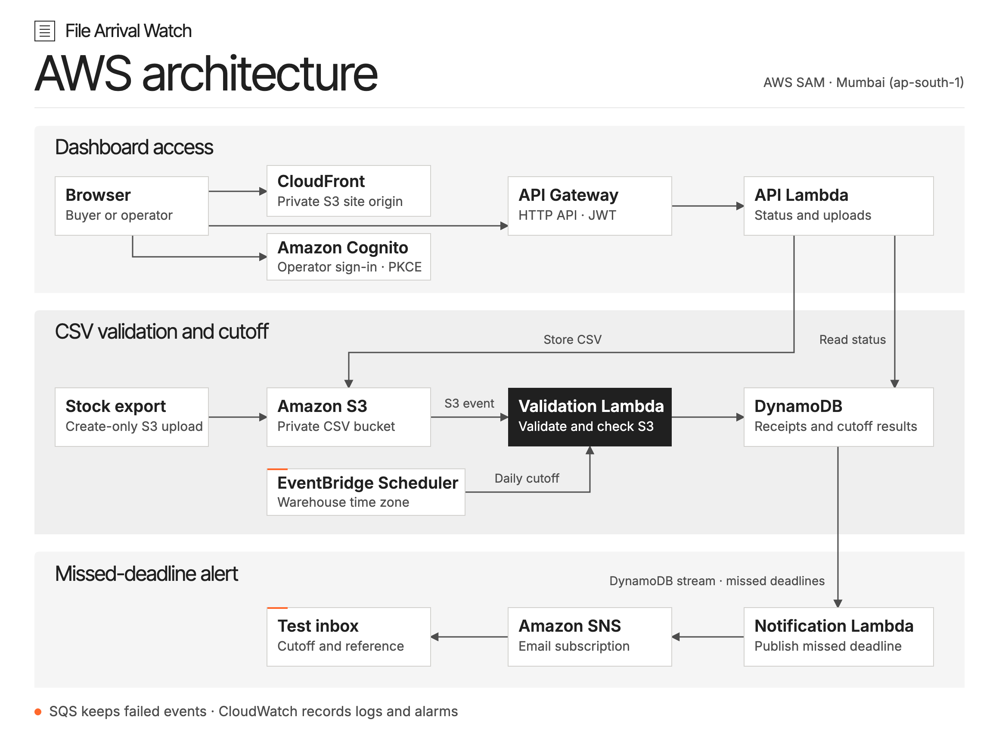

# File Arrival Watch

File Arrival Watch tells a purchasing team whether today’s warehouse stock file is ready for orders. It checks the delivery deadline, rejects stale or incomplete inventory, and updates the dashboard when a corrected file arrives. The hackathon build monitors one warehouse and one daily stock snapshot.

[Architecture details](docs/architecture.md) · [Design reference](DESIGN.md) · [MIT license](LICENSE)

## How it works



1. **Check status.** CloudFront serves the dashboard from a private S3 site bucket. API Gateway and Lambda read readiness from DynamoDB. The dashboard shows today’s status and days with recorded activity within the previous seven warehouse days. Use synthetic inventory in the public demo.
2. **Send inventory.** An operator signs in with Cognito and uploads a CSV. A warehouse export can also write directly to the private upload bucket. An S3 event invokes the shared validator, which records the result and shows actionable errors to the operator.
3. **Check the deadline.** EventBridge Scheduler invokes the same validator at the warehouse cutoff. The worker checks S3 for files received before the deadline, including uploads whose validation events have yet to run. A missed cutoff writes one incident record to DynamoDB.
4. **Alert and recover.** DynamoDB Streams triggers a notification Lambda, which sends an SNS email to a confirmed inbox. A valid late upload changes the status to **Ready · received late** and preserves the original missed deadline in history.

The default cutoff is **8:00 a.m. in `Asia/Kolkata`**. The warehouse time zone determines the business date and the cutoff. **Show times in → My local time** uses the browser’s time zone for display. **First valid file** shows the receipt time of the earliest accepted upload. **Latest upload** shows the newest receipt among attempts that have finished validation, including rejected files.

## Run locally

Use Node.js 22.20 or newer and Python 3.13 or newer.

```bash
npm ci
npm run build
python3 scripts/make-samples.py --output dist/samples
npm run preview
```

Open the [local dashboard](http://127.0.0.1:4173/) and choose **Operator sign in**, then **Sign in to demo**. The local preview simulates operator access, stores deliveries in memory, and uses the current warehouse time. Restarting it resets the local records. To rehearse with a simulated post-cutoff clock, run `npm run preview -- --port 4175 --demo-after-cutoff`. To preview a different warehouse, run `npm run preview -- --port 4175 --timezone America/New_York` and pass the same `--timezone` when generating samples.

| Generated sample | Expected result |
|---|---|
| `stock-stale.csv` | Rejected. The snapshot date is from the previous warehouse day. |
| `stock-incomplete.csv` | Rejected when `STOCK-102` is required, as it is in the preview and the hackathon stack. |
| `stock-valid.csv` | Accepted. It includes both required SKUs and a valid zero quantity. After cutoff it shows **Ready · received late**. |

Upload the generated CSVs from `dist/samples/` in the order shown to try both rejections before the valid delivery. The CSV must be UTF-8, at most 256 KiB and 5,000 data rows, with columns `snapshot_date`, `sku`, and `quantity`. Every row uses the warehouse date (`YYYY-MM-DD`), a unique nonblank SKU, and a nonnegative whole-number quantity. Additional columns are allowed. Run the generator again after a dashboard rebuild, a change to the warehouse time zone, or warehouse midnight.

The [1,502-row replay](samples/stock-seattle-replay-1502.csv) adapts 1,500 public Seattle Public Library catalog entries with physical copy counts, plus two synthetic required SKUs. It uses the January 1, 2017 snapshot for location `col`, summed by catalog number. The `SPL-` prefix distinguishes source records, and `source_snapshot_date` and `source_location` preserve their context. To replay it on a different warehouse date, change only `snapshot_date` in a copy. [City of Seattle source data](https://data.seattle.gov/Community/Library-Collection-Inventory/6vkj-f5xf)

## Verify locally

```bash
npm test
npx playwright install chromium
npm run test:browser
sam validate --lint --region ap-south-1
sam build
```

Run `npm run build` before the browser suite. Use `FILE_ARRIVAL_CHROME_CHANNEL=chrome npm run test:browser` with an installed Google Chrome. The browser suite covers 320, 390, 768, 1024, and 1440 px, keyboard navigation, accessibility checks, time-zone conversion, and the local upload and recovery flow. The backend suite checks CSV validation, warehouse dates, cutoff races, retries, and operational failures. SAM builds the three Python 3.13 Lambda functions.

## Deploy to AWS

Deploy from this project folder with the AWS CLI, SAM CLI, Node.js, and Python 3.13 available. Use an authenticated profile with access to the target AWS account. The example uses profile `hackathon` in Mumbai (`ap-south-1`). For IAM Identity Center, configure `aws configure sso --profile hackathon` and sign in with `aws sso login --profile hackathon`. [AWS CLI installation](https://docs.aws.amazon.com/cli/latest/userguide/getting-started-install.html) · [SAM CLI installation](https://docs.aws.amazon.com/serverless-application-model/latest/developerguide/install-sam-cli.html)

### Build and publish the site

```bash
aws sts get-caller-identity --profile hackathon
npm ci
sam validate --lint --region ap-south-1
sam build
sam deploy --guided --stack-name file-arrival-watch --profile hackathon --region ap-south-1
python3 scripts/publish-web.py --stack file-arrival-watch --profile hackathon --region ap-south-1
```

In the SAM prompts, confirm IAM role creation and set these stack parameters. Choose the demo cutoff far enough ahead to finish CloudFront provisioning, sign in, and confirm the inbox.

| Parameter | Value |
|---|---|
| `WarehouseName` | A public label for the feed. Defaults to `South Warehouse`. |
| `WarehouseTimeZone` | An IANA zone such as `Asia/Kolkata` or `America/New_York`. |
| `CutoffHour` and `CutoffMinute` | Two-digit values in warehouse time. Defaults are `08` and `00`. |
| `RequiredSkus` | Use `STOCK-101,STOCK-102` to match the preview. Leave empty to accept any SKU set that passes CSV validation. |
| `CognitoDomainPrefix` | An available lowercase Cognito domain prefix. |
| `AlertEmail` | A test inbox you control. Confirm the SNS subscription after creation. |

The publish script looks up the stack outputs, syncs the dashboard to the private S3 site bucket, and writes the public API and Cognito settings to `config.json`. Use the CloudFront `SiteUrl` it prints. The browser authenticates operators using Cognito authorization code flow with PKCE.

### Update an existing dashboard in the AWS Console

1. Run `npm ci` and `npm run build`. In CloudFormation, open the stack’s **Outputs** tab and use `SiteBucketName` to find the private website bucket in S3.
2. Upload `app.js`, `auth.js`, `styles.css`, `variables.css`, `favicon.ico`, `LICENSE.txt`, and `fonts/` from `dist/` to the bucket root. Upload `index.html` last. The object keys should be `index.html`, `app.js`, and `fonts/inter.woff2`, for example. Use the existing root `config.json` for this stack and keep public S3 access blocked.
3. If `config.json` is missing, create it using the outputs from the same stack. Map `ApiUrl` to `apiUrl`, `AuthUrl` to `authUrl`, `OperatorClientId` to `clientId`, and `SiteUrl` to `redirectUri`. Copy the full `SiteUrl`, including its trailing slash. Upload the file to the bucket root.
4. Open `SiteUrl` signed out and check **Today**, **History**, and the operator sign-in entry point. If CloudFront still serves older files, create a `/*` invalidation in the distribution from `DistributionId`. Try CSVs through the dashboard after signing in. [S3 console uploads](https://docs.aws.amazon.com/AmazonS3/latest/userguide/upload-objects.html) · [CloudFront invalidation](https://docs.aws.amazon.com/AmazonCloudFront/latest/DeveloperGuide/Invalidation_Requests.html)

### Verify the live stack

1. In the Cognito console, create an operator in the stack’s `UserPoolId`. Choose **Operator sign in** on the dashboard. If the dashboard shows a **Continue to AWS sign-in** button, select it and complete the Cognito sign-in. Confirm the SNS subscription in the test inbox.
2. Open the CloudFront site signed out. Confirm the status loads and upload controls require operator sign-in. Check the public status API and the three protected upload routes with the commands below.
3. Generate same-day synthetic samples for the deployed warehouse time zone. Let an actual scheduled cutoff pass, verify the SNS email, upload the stale CSV, and upload the corrected CSV. Confirm **Ready · received late** signed out. Run an on-time test on another warehouse date or stack.

```bash
stack_output() {
  aws cloudformation describe-stacks --stack-name file-arrival-watch \
    --profile hackathon --region ap-south-1 \
    --query "Stacks[0].Outputs[?OutputKey=='$1'].OutputValue | [0]" --output text
}
api_url="$(stack_output ApiUrl)"
curl -fsS "$api_url/api/status"
curl -sS -o /dev/null -w 'Upload list: %{http_code}\n' "$api_url/api/uploads"
curl -sS -o /dev/null -w 'Upload result: %{http_code}\n' "$api_url/api/uploads/check"
curl -sS -o /dev/null -w 'Upload POST: %{http_code}\n' -X POST "$api_url/api/uploads"
```

Expect `200` for status and `401` for each protected request. To publish a later frontend build, rerun `scripts/publish-web.py`. For changes to Python or the template, rerun `sam validate --lint`, `sam build`, and `sam deploy` with your stack profile.

### Connect a warehouse export

Use an IAM principal permitted to run `s3:PutObject` on `incoming/*` in the stack’s `UploadBucketName`. Set the `snapshot_date` in the CSV and the S3 prefix to the same warehouse date.

```bash
warehouse_zone="Asia/Kolkata"
warehouse_day="$(TZ="$warehouse_zone" date +%F)"
upload_uuid="$(uuidgen | tr '[:upper:]' '[:lower:]')"
aws s3api put-object --profile warehouse-feed --region ap-south-1 \
  --bucket '<UploadBucketName>' \
  --key "incoming/${warehouse_day}/${warehouse_day}_${upload_uuid}.csv" \
  --body ./warehouse-stock.csv --content-type text/csv --if-none-match '*'
```

The bucket enforces create-only uploads. Retry with the same key and bytes. A `412 Precondition Failed` means the key already exists. Check the result in **Today’s upload activity**, and submit corrections under a new UUID. Apply changes to the required SKU list between warehouse days so each day uses consistent rules.

### Operate and remove the stack

- The cutoff is exclusive. A file received at the cutoff is late. S3 receipt times determine the result. Choose the warehouse time zone before opening the feed. A new stack gives a relocated warehouse its own business-date history.
- EventBridge Scheduler adjusts for daylight saving time. If a cutoff falls in an hour that the local clock skips, the dashboard shows that no cutoff was scheduled. [Scheduler time zones](https://docs.aws.amazon.com/scheduler/latest/UserGuide/schedule-types.html#daylight-savings-time)
- **Deadline check delayed** means an outcome is still pending two minutes after cutoff. Check the Worker and NotificationFunction CloudWatch logs and the SQS queue in `FailedEventsUrl`. Once the cause is fixed, replay the original failed Scheduler or S3 event. SNS retries may produce duplicate emails with the same incident reference.
- S3 lifecycle and DynamoDB TTL retain demo records for roughly 30 days. After judging, verify the AWS account and stack, empty the two buckets returned by `SiteBucketName` and `UploadBucketName`, then run `sam delete --stack-name file-arrival-watch --profile hackathon --region ap-south-1`. Verify CloudFormation finishes deleting the stack.

## AWS Builder Center submission

This project targets [Weekend Challenge: No Pipeline, No Problem](https://builder.aws.com/build/hackathons/65918542-15dd-3a71-95ac-76af95da8774/weekend-challenge-no-pipeline-no-problem?tab=rules). The challenge asks for an original, previously unpublished project that uses a serverless AWS service and runs without servers or deployment pipelines to manage. Publish a Builder Center write-up describing the problem and how the AWS services connect. Put a public end-to-end video under three minutes in the **Demo** field. The deadline is **November 17, 2026 at 2:30 a.m. IST**. [Builder Center publishing guide](https://builder.aws.com/content/3JVlS5EVmqlZEcNMWMNeJhln9Sp/introducing-hackathons-on-aws-builder-center)

Use the stack’s `SiteUrl` as the live project link.

## Git workflow

Run the verification commands before committing. Keep recordings, walkthroughs, and recording scripts in the ignored `demo-video/` folder so rebuilding the dashboard leaves them in place. Git also ignores deployment bundles, generated CSVs, dependencies, credentials, and test output.

```bash
git status --short
git add -- .
git diff --cached --check
git diff --cached --stat
git commit -m "Prepare File Arrival Watch"
```

The [GitHub Actions workflow](.github/workflows/verify.yml) runs the dashboard build, backend tests, browser tests, and SAM build on pushes, pull requests, or a manual run. It uses read-only repository permissions and runs without AWS credentials. Publish releases manually using the console or SAM steps above.

## License and project skills

The original application code and project documentation are available under the [MIT License](LICENSE). The included fonts retain their SIL Open Font License notices in the web build. The Seattle sample retains its [source attribution](https://data.seattle.gov/Community/Library-Collection-Inventory/6vkj-f5xf). Third-party materials retain their respective terms.

ECC’s `security-review` and `verification-loop` skills and AWS’s `aws-serverless` skill are installed under `.agents/skills`.
