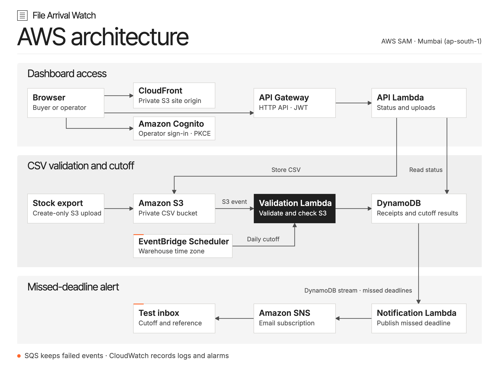

# File Arrival Watch architecture

[Editable architecture diagram](architecture.svg)

CloudFront uses origin access control to serve the dashboard from a private S3 bucket. The browser calls the HTTP API directly. Public status requests can read delivery summaries. The upload routes require an operator access token with the Cognito upload scope.

The API Lambda writes to the separate private CSV bucket. S3 object events and EventBridge Scheduler both invoke the validation worker. The worker writes one result per upload and one cutoff result per business date. Missed cutoff records trigger the notification Lambda through DynamoDB Streams. Exhausted background failures go to SQS, and CloudWatch monitors Lambda errors, API failures, and queue depth.

## HTTP API

| Route | Access | Response |
|---|---|---|
| `GET /api/status` | Public | Warehouse, its IANA time zone, current delivery, and seven previous warehouse dates. Each summary includes the status, reason, receipt time, and original cutoff outcome. |
| `POST /api/uploads` | Operator access token with `file-arrival/upload` scope | `202` with an upload ID. Payload is `{uploadId, csv}`. IDs use the warehouse date followed by an underscore and a UUIDv4. The same ID and bytes are safe to retry. A changed payload or a new upload for an old warehouse date returns `409`. |
| `GET /api/uploads` | Operator access token with upload scope | Up to 10 completed validation attempts for today, most recently validated first. Each includes receipt and validation times, outcome, row count, and any validation errors. |
| `GET /api/uploads/{uploadId}` | Operator access token with upload scope | Processing, accepted, or rejected with receipt time, row count, and up to ten validation errors. Unknown IDs return `404`. |

## Receipt and deadline records

S3 keys are immutable via `If-None-Match: *`. A worker failure can be retried without losing the uploaded file or duplicating a result. At the cutoff, the worker lists the day’s S3 prefix and validates eligible files before creating the deadline record. The first valid receipt governs readiness regardless of event order. Each missed deadline has one incident reference. Standard SNS can redeliver if notification attempts are retried.

The stack’s `WarehouseTimeZone` sets the Scheduler’s time zone and the API’s warehouse date. The scheduled event carries its time zone and cutoff instant so retries use the original business date. DynamoDB stores timestamps in UTC, and alert emails show the cutoff in warehouse time. The dashboard can display times in the browser’s zone while keeping the warehouse date used for each delivery.

DynamoDB partitions are keyed by `WAREHOUSE#YYYY-MM-DD`. Sort keys distinguish the one `DEADLINE` item from each `UPLOAD#<id>` item. Public responses contain delivery metadata only. CSV data stays in S3 and validation messages contain row numbers and rule descriptions.

The optional `RequiredSkus` setting checks that a well-formed snapshot includes each configured critical product. Missing products reject that file. A quantity of zero explicitly records an out-of-stock product. Upload activity shows missing SKU identifiers only to operators. The public dashboard can report an invalid file received after the deadline while preserving that the file was missing at cutoff.

The single-feed demo uses occasional uploads and reads a bounded seven-day display. Public status queries do not require credentials. API throttling limits request bursts. The private origins, short-lived JWT access, scoped IAM roles, and CSP protect the demo boundaries.
